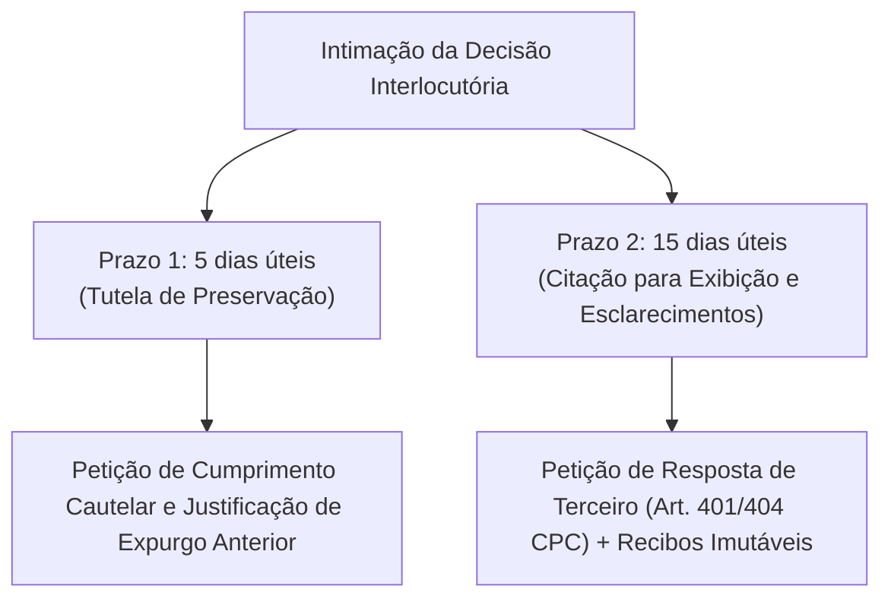

# ⚖️ PARECER TÉCNICO-JURÍDICO & ESTRATÉGIA CONTENCIOSA
**Análise da Minuta de Decisão Interlocutória Simulada (LegisVox v3.0)**  
**Para:** Sócio Responsável / Coordenação Jurídica  
**De:** Analista Jurídico Sênior (Direito Digital & Contencioso Estratégico)  
**Data:** 06 de Outubro de 2026  
**Documento Analisado:** `LegisVox_minuta_decisao_interlocutoria.md`  
**Status do Sistema:** LegisVox v3.0 (Sprints de 05/10/2026 concluídas e ativas em produção)  

---

## SUMÁRIO EXECUTIVO

O presente parecer analisa a **minuta formal de Decisão Interlocutória** simulada pelo juízo cível, instaurada em face da empresa prestadora do LegisVox na qualidade de **terceira interessada e detentora** (arts. 378, 380 e 401 a 404 do CPC), tendo por objeto o Relatório Técnico `LVX-E55349B0`.

Diferentemente do ensaio preliminar de observações, esta decisão adota formato decisório vinculante, cumulando **tutela provisória de urgência cautelar incidental de conservação de registros (arts. 297, 300 e 301 do CPC)** com **citação para incidente de exibição e prestação de esclarecimentos (arts. 380, I e 401 do CPC)**.

A minuta destaca-se por um rigor técnico processual acima da média, prevendo de forma expressa que:
1. Não transfere à prestadora o ônus probatório da parte que juntou o documento;
2. Não antecipa juízo de falsidade, adulteração ou responsabilidade civil;
3. Não impõe à empresa o encargo de custear ou realizar perícia judicial (art. 464 do CPC);
4. Veda pedidos desproporcionais de código-fonte integral, acesso à infraestrutura ou dados de outros clientes.

Entretanto, **cria uma armadilha processual de prazos bipartidos**: assinala **5 dias úteis** para confirmar a preservação ou informar impossibilidade concreta (item 1.2), e **15 dias úteis** para a resposta de exibição e esclarecimentos (item 2.1). 

Sob a ótica do **LegisVox v3.0**, a empresa dispõe de resposta técnica irretorquível: apresentará os **recibos imutáveis de processamento (`processing_receipts`)**, justificará a eliminação física do ZIP e áudios com base na **LGPD e Marco Civil**, e demonstrará que as ocorrências pontuais decorrem de limitações formais de parser e anotações do próprio usuário conferente.

---

## 1. RESUMO DA DECISÃO INTERLOCUTÓRIA SIMULADA

A decisão parte da impugnação da parte adversa quanto à higidez do relatório de 102 páginas emitido pelo LegisVox. O magistrado estrutura o provimento em quatro eixos operacionais:

### 1.1. Tutela de Urgência Cautelar de Preservação (Itens 1.1 e 1.2)
* **Comando:** Intimação da empresa para preservar todos os arquivos e registros ainda existentes do protocolo `LVX-E55349B0`, suspendendo a rotina de exclusão automática pelo prazo inicial de **90 dias**.
* **Prazo Específico de Cumprimento:** **5 dias úteis** para confirmar a adoção da medida ou comprovar impossibilidade concreta e fundamentada.
* **Base Legal:** Arts. 297, 300 e 301 do CPC (poder geral de cautela e conservação de prova).

### 1.2. Citação para Exibição Documental Individualizada (Itens 2.1 e 2.2)
* **Comando:** Citação da prestadora, como terceira detentora (art. 401 do CPC), no prazo de **15 dias úteis**, para exibir:
  - Arquivo `.zip` recebido e texto `_chat.txt`;
  - Mídias utilizadas e áudios transcritos;
  - Versão final do PDF e versões intermediárias/revisadas;
  - Inventários, hashes e registros de recebimento, geração e revisão;
  - Identificação de conta, data, horário UTC e fuso;
  - Documentação técnica vigente à época sobre paridade e conformidade.
* **Salvaguardas do Juízo (Item 2.2):** Exclusão expressa de código-fonte integral, dados de outros clientes, credenciais ou acesso irrestrito ao servidor.

### 1.3. Dever de Informação sobre o Pipeline e IA (Itens 3.1 a 3.5 e 4.1 a 4.7)
* Com base no **art. 380, I, do CPC**, a empresa deve esclarecer fatos técnicos de seu conhecimento:
  - Extração no celular vs. upload em nuvem (o que foi checado vs. o que foi declarado pelo usuário);
  - Correlação e momento do cálculo do hash SHA-256 impresso;
  - Transformações no texto/mídias, uso de IA e vedação de reescrita/resumo/reordenação;
  - Associação de áudio/transcrição/remetente, versões de modelos e temperatura;
  - Existência e alcance de revisão humana.
* **Ocorrências específicas:** Aviso de segurança colado na pág. 22; ressalva `"[5] Não"` na pág. 101; contagem divergente na pág. 102 (6 declaradas vs. 5 identificadas); critério de quantitativos e fundamento de *"100% de paridade"*; mídias indisponíveis vs. fidelidade semântica; carimbo temporal e escopo da declaração ISO/IEC 27037.

### 1.4. Regramento da Indisponibilidade, Contraditório e Sanções (Itens 5.1 a 7.4)
* **Impossibilidade de Exigir o Impossível (Item 5.1):** A terceira **não está obrigada** a produzir laudo pericial novo, desenvolver software ou criar registros históricos inexistentes.
* **Justificativa Individual (Item 5.2):** Para cada item não apresentado, indicar se nunca produzido, se eliminado (com data, motivo e política), se sob guarda de terceiro ou se amparado por escusa legítima (art. 404 do CPC).
* **Segredo de Justiça (Item 6.1):** Tramitação sob acesso restrito para preservação de dados pessoais e intimidade (art. 189, III, do CPC).
* **Ausência de Sanção Automática (Itens 7.1 a 7.4):** Negada a posse, aplica-se o rito do **art. 402 do CPC** (audiência especial prévia), afastando-se a presunção de recusa ilegítima ou aplicação sumária de medidas coercitivas do art. 403 do CPC. A prestadora **não arcará com custeio de perícia**.

---

## 2. ANÁLISE DOS FUNDAMENTOS DA DECISÃO (PONTOS FORTES, FRACOS E VÍCIOS)

| Aspecto Processual | Análise Crítica Técnico-Jurídica | Dispositivos Aplicáveis |
| :--- | :--- | :--- |
| **Pontos Fortes da Decisão (Excelente Técnica)** | **Equilíbrio, Contraditório e Proporcionalidade:** O juízo construiu uma decisão blindada contra abusos comuns: resguardou o segredo de negócio (sem código-fonte ou credenciais), isentou o terceiro de custear perícia, não transferiu o ônus da prova do autor/réu para a empresa e garantiu audiência prévia (art. 402, CPC) antes de qualquer sanção do art. 403. | Arts. 8º, 380, 401, 402 e 464 do CPC. |
| **Ponto Crítico: A Armadilha dos Prazos Bipartidos** | **Risco Operacional Imediato:** A decisão fixa **dois prazos distintos**: **5 dias úteis** para confirmar a preservação da tutela cautelar (item 1.2) e **15 dias úteis** para a resposta de exibição (item 2.1). O escritório não pode aguardar os 15 dias para peticionar, sob pena de incorrer em descumprimento formal da tutela cautelar. | Arts. 297, 301 e 401 do CPC. |
| **Ponto Fraco: Descompasso entre Exibição e Perícia** | **Exorbitância do Dever de Terceiro:** Embora afirme não impor encargo pericial, os itens 4.1 a 4.7 exigem da empresa a elucidação analítica e pericial de ocorrências materiais do documento, ultrapassando o dever de simples exibição e cooperação informativa sobre fatos próprios (art. 380, I do CPC). | Arts. 380 c/c 464 do CPC. |
| **Vício Potencial: Tutela sem Contraditório Prévio** | **Ausência de Demonstração de Risco Iminente:** A concessão liminar da ordem de preservação de 90 dias baseou-se genericamente na publicidade de descarte do app. Tratando-se de terceiro, a medida só se justifica se demonstrada a probabilidade de destruição ilícita, o que é afastado pela própria rotina de privacidade da LGPD. | Arts. 9º, 10 e 300 do CPC. |

---

## 3. TESES DE DEFESA E RESPALDO JURÍDICO APLICÁVEIS (LEGISVOX v3.0)

A defesa do LegisVox deve harmonizar a postura colaborativa com a realidade técnica implementada em produção após as Sprints de 05/10/2026:

### TESE 1: Do Cumprimento Imediato da Tutela Cautelar (Prazo de 5 Dias) e da Impossibilidade Material sobre Dados Eliminados
> **Fundamentação:** Arts. 297, 300 e 404, VI do CPC; Art. 6º, III e VII da LGPD.

1. **Ação nos primeiros 5 dias:** Peticionar comprovando que a empresa realizou o bloqueio lógico imediato de qualquer expurgo sobre o protocolo `LVX-E55349B0`.
2. **Declaração de Inexistência sem Desobediência:** Esclarecer de plano que os arquivos brutos (`.zip`, `_chat.txt` e áudios) **já haviam sido eliminados no prazo regulamentar de 24 horas** muito antes da intimação judicial, em razão da Política de Retenção Zero (ZDR) da plataforma, fulcrada no princípio da minimização de dados da LGPD.
3. Não há descumprimento: o próprio item 33 da fundamentação e o item 5.1 da decisão ressalvam que a medida **não exige a recuperação ou recriação de conteúdo previamente eliminado**.

---

### TESE 2: Da Escusa Legítima pela Natureza do Marco Civil da Internet e da Proteção de Dados de Terceiros
> **Fundamentação:** Art. 404, VI do CPC; Art. 15 da Lei 12.965/2014; Art. 5º, X da CF/88; Art. 16 da LGPD.

1. O **art. 15 do Marco Civil da Internet** circunscreve a obrigação legal de retenção aos *registros de acesso a aplicações* (IP, data, hora e porta) pelo prazo de 6 meses.
2. A ordem jurídica brasileira **veda a retenção indiscriminada de dados de conteúdo privado de terceiros** (áudios, conversas íntimas, fotografias) sem ordem judicial anterior ao término do tratamento.
3. Manter cópia perpétua das conversas constituiria ilícito administrativo e civil perante a ANPD e os titulares de dados. Trata-se de hipótese cabal de **escusa legítima de terceiro prevista no art. 404, VI do CPC**.

---

### TESE 3: Da Delimitação de Documento Particular e do Ônus Probatório Imputável à Parte Litigante
> **Fundamentação:** Arts. 408 e 411, III do CPC; Lei 8.935/1994; Art. 384 do CPC a contrario sensu.

1. O relatório do LegisVox é expressamente intitulado **"Relatório Técnico de Transcrição e Organização"** (alteração definitiva em `pdf_generator.py`).
2. O sistema **não confere fé pública notarial** e **não substitui perícia oficial de extração de dispositivo móvel**.
3. O LegisVox opera via nuvem: **nunca apreendeu, operou ou conectou-se ao smartphone**. A extração deu-se pelo mecanismo nativo do WhatsApp acionado pela própria parte.
4. Conforme o **art. 411, III do CPC**, a veracidade do contexto e da origem das declarações constantes do documento compete à parte que o apresentou como meio de prova em juízo, e não ao provedor da ferramenta de software.

---

### TESE 4: Da Trilha Probatória Positiva por Recibos Imutáveis e Transparência Algorítmica da IA
> **Fundamentação:** Art. 378 do CPC; Art. 20 da LGPD (Transparência Algorítmica).

1. O LegisVox cumpre o dever de colaboração apresentando a certidão imutável das tabelas `processing_receipts` e `pdf_issuance_receipts` (App v3.0, *append-only*):
   - **Hash SHA-256 do arquivo ZIP** no exato momento da entrada;
   - **Inventário arquivo por arquivo contido no ZIP**, discriminando nome, tamanho e hash individual de cada áudio/texto;
   - Modelo exato de IA utilizado (`gpt-4.1-mini`), modelo de transcrição (Whisper via Groq), temperatura (`0.1`, determinística) e versão do app (`3.0`).
2. **Inexistência de Reescrita ou Censura:** Os prompts do sistema operam sob parâmetros rígidos de organização estrutural, vedando reescrita, resumo ou alteração de sentido semântico.
3. As requisições utilizam APIs corporativas comerciais que proíbem expressamente a retenção em repouso e o uso dos dados para retreinamento de IA pública.

---

### TESE 5: Do Esclarecimento Concreto das Ocorrências Técnicas Apontadas (Páginas 22, 101 e 102)
> **Fundamentação:** Art. 5º do CPC (Boa-Fé Objetiva Processual); Ausência de Falsidade Ideológica.

* **Página 22 (Aviso de segurança incorporado à fala):** Limitação formal conhecida do algoritmo de segmentação (*parser regex*) ao tratar quebras de linha no arquivo `_chat.txt` gerado pelo WhatsApp. O texto já existia no arquivo fornecido; o parser apenas não o isolou em linha autônoma. Não houve intervenção dolosa ou alucinação de IA.
* **Páginas 101 e 102 (Anotação `"[5] Não"` e contagem 6 vs. 5):** Inserção manual efetuada pelo **próprio usuário conferente** na interface web. A divergência quantitativa decorria da edição manual de notas no modelo legado; na versão 3.0 atual (Sprints 1 e 2), o código garante equivalência matemática automática (`len(printed) == declared`) e o salvamento prévio antes do PDF.
* **Mídias Indisponíveis:** O relatório reflete a exportação nativa do WhatsApp, que omite arquivos pesados ou não baixados no aparelho. Ausência na origem, não falha da plataforma.
* **Carimbo Temporal e Menção ISO 27037:** "Carimbo temporal" é a preservação da data textual do WhatsApp, sem vinculação a carimbo do tempo ICP-Brasil (RFC 3161). A menção à ISO 27037 traduzia a adoção de boas práticas de integridade por hash SHA-256, sem certificação externa independente — razão pela qual **o selo foi removido do cabeçalho na v3.0**, eliminando qualquer ambiguidade.

---

## 4. MEDIDAS PROCESSUAIS CABÍVEIS (ANÁLISE COMPARATIVA)



| Medida Processual | Cabimento e Finalidade | Prazo Legal | Nível de Risco | Recomendação Estratégica |
| :--- | :--- | :--- | :--- | :--- |
| **1. Petição de Cumprimento Cautelar (Item 1.2)** | Informar o congelamento do protocolo no banco e justificar que o ZIP/áudios já haviam sido eliminados antes da ordem (ZDR/LGPD). | **5 dias úteis** | **Mínimo** | **OBRIGATÓRIA E IMEDIATA.** Afasta qualquer alegação de desobediência à tutela de urgência. |
| **2. Petição de Resposta e Exibição de Terceiro (Arts. 401 e 404, CPC)** | Apresentar os esclarecimentos técnicos (itens 3.1 a 5.3), juntar o espelho de `processing_receipts` e delimitar o documento como particular. | **15 dias úteis** | **Baixo** | **PRIORITÁRIA DE MÉRITO.** Cumpre integralmente o dever de terceiro e esvazia qualquer incidente sancionador. |
| **3. Embargos de Declaração (Art. 1.022, CPC)** | Esclarecer eventual contradição entre os 5 dias de preservação e os 15 dias de citação. | **5 dias úteis** | **Médio** | **Desnecessária.** É preferível cumprir a preservação em 5 dias e exibir em 15 dias, evitando atrito com o juiz. |
| **4. Agravo de Instrumento (Art. 1.015 c/c Tema 988/STJ)** | Recorrer da decisão interlocutória de tutela cautelar imposta a terceiro. | **15 dias úteis** | **Alto** | **CONTRAINDICADA.** A decisão é razoável e isenta a empresa de custeio/perícia. Agravar geraria desgaste prematuro. |
| **5. Mandado de Segurança (Lei 12.016/2009)** | Remédio constitucional contra atos ilegais ou abusivos. | **120 dias** | **Alto** | **RESERVA.** Acionar apenas se o juízo, no futuro, determinar busca e apreensão ou quebra de sigilo da base geral. |

---

## 5. ESTRATÉGIA RECOMENDADA & MATRIZ DE CENÁRIOS

### 5.1. Cronograma de Ação Estratégica Bipartido
* **Fase 1 (D+1 a D+4): Resposta à Tutela Cautelar (Meta: 5 dias úteis)**
  - Protocolar petição simples informando: (i) adoção da ordem de congelamento de qualquer registro remanescente por 90 dias; (ii) informação fundamentada de que o arquivo `.zip` e os áudios foram fisicamente descartados em 24h na data do processamento por dever da LGPD, restando preservados os recibos imutáveis.
* **Fase 2 (D+5 a D+13): Resposta de Exibição e Esclarecimentos (Meta: 15 dias úteis)**
  - Juntar o extrato do recibo imutável de processamento (`processing_receipts`), cópia do PDF emitido, Nota Técnica do CTO explicando o parser regex e comprovantes de termos das APIs corporativas.
  - Requerer tramitação sob segredo de justiça (art. 189, III, do CPC) e a desoneração do terceiro de qualquer encargo probatório.

### 5.2. Matriz de Cenários

```
┌────────────────────────────────────────────────────────────────────────────────────────┐
│                                   MATRIZ DE CENÁRIOS                                   │
├─────────────────────┬─────────────────────────────────┬────────────────────────────────┤
│ Cenário Otimista    │ Cenário Provável                │ Cenário Pessimista             │
├─────────────────────┼─────────────────────────────────┼────────────────────────────────┤
│ O magistrado dá a   │ O juiz abre vista às partes     │ O juiz não se convence das     │
│ ordem por cumprida, │ litigantes (item 6.4); a parte  │ limitações técnicas do parser  │
│ homologa os recibos │ impugnante impugna as teses;    │ e designa audiência especial   │
│ imutáveis e libera a│ o juiz fixa perícia judicial    │ (art. 402 do CPC) para inquirir│
│ empresa de qualquer │ oficial diretamente nos         │ o CTO do LegisVox sobre a      │
│ ato processual.     │ celulares das partes litigantes,│ esteira de IA (hipótese para   │
│                     │ liberando o LegisVox.           │ a qual a Nota Técnica blinda). │
└─────────────────────┴─────────────────────────────────┴────────────────────────────────┘
```

---

## 6. ESBOÇO DA PEÇA PROCESSUAL DE RESPOSTA

```markdown
EXCELENTÍSSIMO SENHOR DOUTOR JUIZ DE DIREITO DA [VARA CÍVEL DA COMARCA]
Autos do Processo nº [NÚMERO DO PROCESSO]
Incidente de Exibição e Esclarecimentos de Terceiro

[RAZÃO SOCIAL RESPONSÁVEL PELO LEGISVOX], devidamente qualificada nestes autos, por seus advogados constituídos, em atenção à r. Decisão Interlocutória proferida, vem respeitosamente perante Vossa Excelência expor e requerer o que segue:

I. DO CUMPRIMENTO TEMPESTIVO DA TUTELA CAUTELAR DE PRESERVAÇÃO (ITEM 1.2)
Em estrito cumprimento ao item 1.2 da decisão, a Requerente informa que procedeu ao bloqueio imediato de expurgo de todos os registros e metadados existentes relativos ao protocolo LVX-E55349B0 pelo prazo assinalado de 90 dias.
Outrossim, em cumprimento ao dever de prestar informação imediata, esclarece que o arquivo .ZIP original e os áudios brutos foram fisicamente eliminados de seus servidores no prazo regulamentar de 24 horas após a emissão do documento, em estrita observância à sua Política de Retenção Zero (ZDR), ao Princípio da Minimização de Dados (art. 6º, III, da Lei 13.709/2018 - LGPD) e ao art. 15 da Lei 12.965/2014 (Marco Civil da Internet), configurando escusa legítima por impossibilidade material fática anterior à ordem judicial (art. 404, VI, do CPC).

II. DA RESPOSTA AO PEDIDO DE EXIBIÇÃO E DA JUNTADA DE RECIBOS IMUTÁVEIS (ITENS 2.1 E 3.1 A 3.5)
Embora os arquivos brutos não mais existam em disco, a plataforma disponibiliza os registros históricos e imutáveis gravados em suas tabelas de auditoria (processing_receipts e pdf_issuance_receipts), anexando:
a) Hash SHA-256 do arquivo ZIP recebido;
b) Inventário individual de cada arquivo contido no ZIP (nomes, tamanhos e seus respectivos hashes SHA-256 calculados no upload);
c) Versão do software (APP_VERSION 3.0), modelo de linguagem (gpt-4.1-mini) e de transcrição (Groq Whisper), operando sob temperatura 0.1, sem permissão algorítmica para reescrita, resumo ou alteração do teor semântico das falas.

III. DOS ESCLARECIMENTOS ESPECÍFICOS SOBRE AS OCORRÊNCIAS (ITENS 4.1 A 4.7)
1. Pág. 22: O aviso de segurança associado à fala de participante resultou de limitação computacional de segmentação de quebras de linha do parser regex sobre o arquivo _chat.txt do WhatsApp. O texto já existia no arquivo fornecido pelo usuário e não sofreu intervenção de IA;
2. Págs. 101/102: As ressalvas e anotações técnicas decorrem de intervenção exclusiva do usuário conferente na interface web, sendo o LegisVox mero prestador de software particular de organização documental, sem fé pública notarial e sem atribuição pericial judicial (art. 411, III, do CPC);
3. Mídias Indisponíveis: Refletem a ausência de envio dos arquivos pelo WhatsApp durante a exportação pelo cliente;
4. ISO/IEC 27037: Tratava-se de autodeclaração principiológica de custódia e integridade via resumo criptográfico SHA-256. Em prol da clareza e transparência, o selo foi expressamente suprimido do cabeçalho na versão 3.0 em produção.

IV. DOS PEDIDOS
Diante do exposto, requer-se:
1. O recebimento da presente manifestação e dos documentos técnicos anexos, dando-se por integralmente cumpridas as determinações da decisão interlocutória;
2. A tramitação deste incidente e dos arquivos em Segredo de Justiça / Acesso Restrito (art. 189, III, do CPC e LGPD);
3. A desoneração formal do LegisVox de quaisquer providências periciais, facultando-se a realização de perícia técnica judicial diretamente sobre os smartphones dos litigantes.

Termos em que pede deferimento.
[Local], [Data].
[Nome do Advogado] — OAB/[UF]
```

---

## 7. CHECKLIST PROBATÓRIO PARA O SÓCIO REUNIR

- [ ] **Certidão de Bloqueio de Expurgo:** Declaração técnica do DBA ou desenvolvedor atestando o congelamento do protocolo no banco por 90 dias.
- [ ] **Extrato do Recibo de Processamento:** Cópia da linha correspondente na tabela `processing_receipts` contendo os metadados do ZIP e o inventário de arquivos.
- [ ] **Extrato do Recibo de Emissão:** Cópia da linha na tabela `pdf_issuance_receipts` contendo o hash do PDF emitido.
- [ ] **Cópia do PDF Emitido:** Arquivo PDF idêntico ao entregue ao cliente para confrontação de integridade SHA-256.
- [ ] **Nota Técnica Explicativa do Parser Regex:** Laudo do CTO demonstrando que o código-fonte processa o `_chat.txt` de forma determinística e não altera textos de mensagens.
- [ ] **Termos Comerciais das APIs:** Cópia dos termos da OpenAI e Groq garantindo a política de Retenção Zero e vedação de retreinamento de modelos.
- [ ] **Logs de Acesso do Usuário:** Endereço IP, data e hora da conexão do usuário no momento do upload (em observância ao art. 15 do Marco Civil da Internet).

---

> ⚠️ **AVISO LEGAL OBRIGATÓRIO:**  
> O presente documento constitui subsídio técnico e estratégico consultivo, voltado ao ensaio simulado de contingência contenciosa. As teses jurídicas, estratégias processuais e minutas contidas neste parecer devem ser submetidas à análise, validação e assinatura final do advogado responsável antes de sua utilização formal em qualquer processo judicial.
