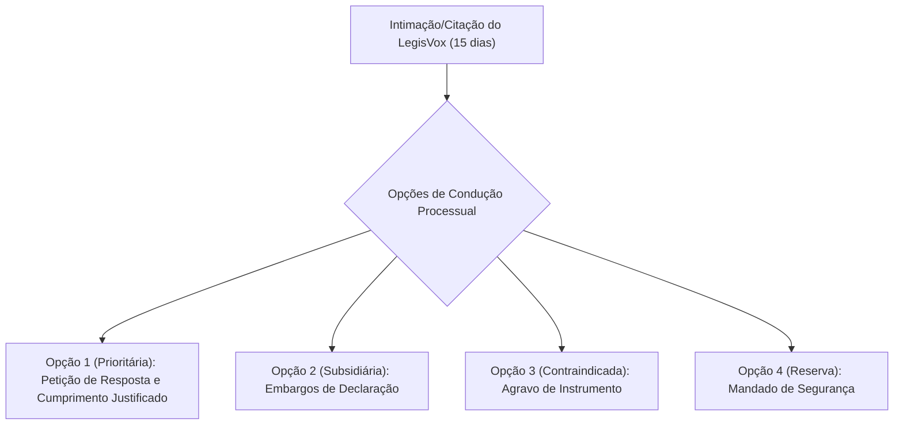

# ⚖️ PARECER TÉCNICO-JURÍDICO & ESTRATÉGIA CONTENCIOSA
**Documento de Apoio Estratégico ao Contencioso Cível e Direito Digital**  
**Para:** Sócio Responsável / Coordenação Jurídica  
**De:** Analista Jurídico Sênior (Direito Digital & Contencioso Estratégico)  
**Data:** 06 de Outubro de 2026  
**Status do Sistema:** LegisVox v3.0 (Pós-Sprints 1 a 5 concluídas em 05/10/2026)  
**Objeto:** Análise da Ordem Judicial Simulada ref. Protocolo `LVX-E55349B0` e Formulação de Resposta Técnica e Processual  

---

## SUMÁRIO EXECUTIVO

O presente parecer consolida a análise técnico-jurídica da ordem judicial simulada elaborada para avaliar a resiliência contenciosa do LegisVox na qualidade de terceiro prestador de serviço tecnológico em ação cível. 

A análise incorpora o estado atualizado da plataforma (**LegisVox v3.0**, decorrente das Sprints de 05/10/2026), que saneou todas as promessas mercadológicas de cunho pericial ou notarial, unificou as anotações do sistema, implementou recibos de auditoria imutáveis (*append-only*: `processing_receipts` e `pdf_issuance_receipts`) e consolidou a política de Retenção Zero (*Zero Data Retention - ZDR*).

Conclui-se que o LegisVox possui **plena e sólida defesa técnico-jurídica**. A resposta a ser apresentada ao juízo fundamenta-se na transparência algorítmica, na impossibilidade material legítima de apresentar o arquivo `.zip` e áudios brutos (exigência da LGPD e do Marco Civil da Internet), e na delimitação da natureza do relatório como **documento particular de organização documental**, transferindo à parte litigante o ônus probatório sobre os eventos ocorridos no aparelho celular de origem.

---

## 1. RESUMO DA ORDEM JUDICIAL SIMULADA

A decisão judicial simulada foi construída a partir da hipótese em que uma das partes litigantes apresenta em juízo um relatório emitido pelo LegisVox (Protocolo `LVX-E55349B0`, com 102 páginas), o qual é objeto de impugnação específica e detalhada pela parte adversa.

O magistrado intervém no feito tratando o LegisVox como **terceiro estranho à lide principal**, instaurando o procedimento de cooperação e exibição documental previsto nos **arts. 378, 380 e 401 a 404 do Código de Processo Civil (CPC)**.

### 1.1. Determinações do Juízo
1. **Preservação Cautelar (Itens 1.1 e 1.2):** Determinação para suspender rotinas automáticas de expurgo e preservar todos os registros, arquivos e versões relacionados exclusivamente ao protocolo `LVX-E55349B0`.
2. **Citação e Qualificação (Itens 2.1 a 2.4):** Prazo de **15 dias** para qualificar a PJ e responsável técnico, informar data/hora UTC e conta solicitante, esclarecer se houve acesso ao aparelho celular e discriminar quais dados foram checados pela plataforma e quais foram meramente declarados pelo usuário.
3. **Exibição Documental (Itens 3.1 a 3.5):** Ordem para apresentar, se existentes: o `.zip` original, o arquivo `_chat.txt`, as mídias, o PDF final, versões intermediárias, inventário com hashes individuais dos arquivos e a correspondência do hash impresso no documento.
4. **Esclarecimento da Esteira de Processamento e IA (Itens 4.1 a 4.6):** Exigência de discriminação entre regras de código e inteligência artificial, verificação de eventual reescrita/resumo de mensagens, critérios de identificação de avisos de sistema, versões de modelos/temperatura e comprovação de revisão humana.
5. **Esclarecimento de Incongruências Concretas no Relatório (Itens 5.1 a 5.7):**
   - **Pág. 22:** Aviso de alteração de código de segurança incorporado dentro da mensagem de um participante com horário distinto.
   - **Pág. 101:** Origem e autoria da ressalva manuscrita/inserida `"[5] Não"`.
   - **Pág. 102:** Divergência quantitativa entre 6 observações declaradas e apenas 5 notas listadas (`[1]` a `[5]`).
   - Apuração dos quantitativos (1.692 registros, 125 áudios, 155 arquivos) e do fundamento da expressão *"100% de paridade"*.
   - Compatibilização entre *"ausência de omissões"* e menções a *"Mídia não disponível no export"*.
   - Significado técnico de *"carimbo temporal intacto"*.
6. **Conformidade ISO/IEC 27037 (Itens 6.1 a 6.4):** Indicação da edição da norma, procedimentos abrangidos, esclarecimento sobre certificação própria vs. auditoria externa e alcance prévio ao upload.
7. **Justificativa de Indisponibilidade e Segredo (Itens 7.1 a 8.3):** Declaração formal e fundamentada da causa de indisponibilidade de documentos não apresentados; regime de tramitação sob acesso restrito para proteção de dados pessoais e sigilo negocial; remessa dos autos às partes para manifestação prévia a eventual deliberação pericial.

### 1.2. Prazos e Consequências Cominadas
* **Prazo de Resposta:** 15 dias úteis (rito do art. 401 do CPC).
* **Consequências Imediatas:** A decisão **não impôs multa cominatória diária (astreintes)**, nem busca e apreensão ou suspensão dos serviços da empresa. Contudo, pelo regramento do art. 403, parágrafo único, do CPC, a omissão injustificada do terceiro enseja a expedição de mandado de apreensão e a apuração de responsabilidade civil e processual (ato atentatório à dignidade da justiça - art. 77 do CPC).

---

## 2. ANÁLISE CRÍTICA DOS FUNDAMENTOS DA DECISÃO

| Dimensão Processual | Avaliação Crítica | Dispositivo Legal |
| :--- | :--- | :--- |
| **Pontos Fortes da Ordem Judicial** | **Contenção e Boa Técnica:** O juiz evitou atitudes açodadas ou gravosas. Não presumiu dolo ou fraude da empresa (item 8.3), delimitou estritamente o dever de preservação ao caso em debate (item 1.2), facultou o sigilo empresarial (item 8.2) e expressamente ressalvou a não exigência de criação retroativa de registros inexistentes (item 7.3). | Arts. 378, 401 e 404 do CPC. |
| **Ponto Fraco: Transmutação de Terceiro em Perito** | **Excesso de Encargo ao Terceiro:** O dever do terceiro no art. 380 do CPC limita-se a exibir coisas e documentos que já se encontram em seu poder físico. A decisão confunde esse dever de colaboração documental com a imposição de um encargo pericial investigativo complexo, exigindo da empresa laudo de mérito que caberia a um perito judicial nomeado. | Arts. 380, II, 401 e 464 do CPC. |
| **Ponto Fraco: Obrigação Materialmente Impossível** | **Desconhecimento da Natureza SaaS:** Exigir que a plataforma ateste o que ocorreu no hardware do usuário antes do upload (itens 2.3, 2.4 e 6.4) impõe dever irrealizável (*ad impossibilia nemo tenetur*). O aplicativo opera como processador em nuvem de arquivo fornecido pelo usuário. | Art. 8º do CPC (Razoabilidade). |
| **Vício Processual Formal** | **Ambiguidade entre Intimação e Citação:** O despacho determina cautelarmente *"intime-se"* (item 1.1) e cognitivamente *"cite-se"* (item 45). Tratando-se de terceiro interveniente forçado por incidente de exibição, é imprescindível a **citação formal** sob pena de nulidade do incidente. | Arts. 238 e 401 do CPC; Art. 5º, LIV e LV da CF/88. |

---

## 3. TESES DE DEFESA ATUALIZADAS (LEGISVOX v3.0)

A resposta do LegisVox ancora-se nas modificações técnicas implementadas nas Sprints de 05/10/2026 (`APP_VERSION 3.0`), que conferem sustentação fática verídica a quatro teses jurídicas principais:

### TESE 1: Da Escusa Legítima por Impossibilidade Material — Estrito Cumprimento da LGPD e do Marco Civil da Internet
> **Dispositivos:** Art. 404, VI do CPC; Art. 6º, III e VII da LGPD (Lei 13.709/2018); Art. 15 da Lei 12.965/2014 (Marco Civil da Internet).

1. **A Inexistência em Disco do Arquivo ZIP e Mídias:** A empresa não dispõe mais do arquivo `.zip` original nem dos áudios brutos, pois foram definitivamente excluídos do servidor no prazo de 24 horas após o processamento, por meio da rotina automatizada `delete-old-atas`.
2. **Legalidade do Descarte:** A não apresentação desses arquivos não configura descumprimento, ocultação ou desídia, mas **escusa legítima amparada em impossibilidade material lícita (art. 404, VI, do CPC)**.
3. **Imperativo da LGPD:** O LegisVox opera sob o princípio da **minimização de dados (art. 6º, III, LGPD)** e política rigorosa de **Retenção Zero (Zero Data Retention - ZDR)**. Reter em disco bancos de conversas particulares, áudios íntimos e segredos empresariais de terceiros alheios à plataforma configuraria tratamento excessivo e abusivo de dados pessoais, sujeitando a empresa a sanções da ANPD e responsabilidade civil.
4. **Regramento do Marco Civil da Internet:** O art. 15 da Lei 12.965/2014 impõe aos provedores de aplicação o dever de guarda estrito de **registros de acesso a aplicações de internet** (endereço IP, porta lógica, data e hora) pelo prazo de 6 meses. O ordenamento jurídico brasileiro **não impõe e veda a retenção indiscriminada de dados de conteúdo de mensagens e mídias privadas** sem prévia e fundamentada ordem judicial expedida antes do expurgo regulamentar.

---

### TESE 2: Da Delimitação da Natureza de Documento Particular e da Inexistência de Usurpação Notarial ou Pericial
> **Dispositivos:** Arts. 408 e 411, III do CPC; Art. 384 do CPC *a contrario sensu*; Lei 8.935/1994; Art. 212 do Código Civil.

1. **Documento Particular de Organização:** O produto emitido pelo LegisVox ostenta expressamente a natureza de **"Relatório Técnico de Transcrição e Organização"** (alteração definitiva em `pdf_generator.py`). Trata-se de documento particular encomendado privadamente pela parte para organizar cronologicamente dados textuais e transcrever áudios.
2. **Inexistência de Fé Pública Notarial ou Laudo Pericial:**
   - O LegisVox não é cartório e não lavra ata notarial (ato privativo de tabelião dotado de fé pública delegada pelo Estado — Lei 8.935/94 e art. 384 do CPC);
   - A plataforma não atuou como perito judicial nomeado pelo juízo (art. 464 do CPC);
   - O sistema declarou expressamente no verificador público e no próprio documento: *"Declaração da própria plataforma, sem avaliação independente"*.
3. **Ônus Probatório da Origem Imputável à Parte:** O LegisVox opera na modalidade SaaS via upload. Nunca apreendeu nem acessou o smartphone de origem. O processo de extração deu-se pelo recurso nativo do WhatsApp executado pela própria parte. Desse modo, nos moldes do **art. 411, III do CPC**, o encargo de comprovar a higidez e a autenticidade da conversa original compete à parte que instruiu a ação com o relatório, e não ao provedor do software de organização.

---

### TESE 3: Da Trilha de Auditoria Positiva por Recibos Imutáveis e Transparência Algorítmica da IA
> **Dispositivos:** Art. 378 do CPC (Dever de Colaboração); Art. 20 da LGPD (Transparência Algorítmica); Art. 402 do CPC.

1. **Recibos de Auditoria Imutáveis (App v3.0):** Em cumprimento ao dever de colaboração, a empresa apresenta o espelho imutável da tabela `processing_receipts` e `pdf_issuance_receipts`. Trata-se de tabelas segregadas, *append-only* (protegidas por triggers no PostgreSQL contra qualquer edição ou exclusão), que preservam permanentemente:
   - Identificação do protocolo (`LVX-E55349B0`) e carimbo UTC do upload;
   - Nome, tamanho e **hash SHA-256 do arquivo ZIP recebido**;
   - **Inventário arquivo por arquivo** contido no ZIP (nomes, tamanhos e seus respectivos hashes SHA-256 individuais);
   - Totais apurados pelo parser de mensagens e áudios;
   - Modelo exato de IA utilizado (`gpt-4.1-mini`), modelo de transcrição (Whisper via Groq), temperatura configurada (`0.1`, determinística) e versão do aplicativo (`APP_VERSION 3.0`).
2. **Integridade Criptográfica do PDF:** O algoritmo SHA-256 gerado na compilação do relatório final vincula-se ao documento entregue à parte. O verificador público do LegisVox atesta que o arquivo constante dos autos judiciais é matematicamente idêntico ao emitido pelo sistema em sua data de geração.
3. **Inexistência de Reescrita ou Censura:** Esclarece-se que as requisições tramitam via APIs comerciais corporativas sob cláusulas rígidas de vedação de treinamento de modelos públicos e criptografia TLS 1.3. Não há rotina de código ou prompt que permita resumir, omitir ou alterar o teor semântico das conversas.

---

### TESE 4: Da Justificação Técnica Concreta das Ocorrências Apontadas pelo Juízo (Páginas 22, 101 e 102)
> **Dispositivos:** Art. 5º do CPC (Boa-Fé Objetiva Processual); Ausência de Falsidade Material ou Ideológica.

1. **Aviso de Segurança Colado na Página 22:**
   - *Explicação:* Trata-se de limitação técnica de segmentação computacional (*parser regex*) ao processar as quebras de linha nativas do arquivo `_chat.txt` gerado pelo WhatsApp. O aviso de alteração de código de segurança já constava do arquivo original do WhatsApp e foi erroneamente agrupado na linha de diálogo do participante imediatamente anterior.
   - *Conclusão:* Erro estritamente formal de diagramação, sem inserção indevida de dados ou intervenção fraudulenta de inteligência artificial.
2. **Ressalva/Anotação `"[5] Não"` (Página 101) e Divergência de Contagem 6 vs. 5 (Página 102):**
   - *Explicação:* O LegisVox oferece na interface web campos para que o advogado conferente insira observações e anotações técnicas. A anotação `"[5] Não"` foi inserida **diretamente pelo usuário da conta**, cujas marcações são impressas no relatório final.
   - *Solução na Versão Atual:* No modelo legado, a divergência numérica decorria da exclusão ou reedição manual de notas pelo usuário sem atualização dinâmica do contador. Na versão 3.0 atual (Sprint 1 e 2), o sistema garante por código que a contagem do quadro-resumo seja perfeitamente idêntica às anotações impressas (`len(printed) == declared`).
3. **"Mídia não disponível no export":**
   - *Explicação:* O sistema reflete a realidade do arquivo fornecido pelo WhatsApp. O aplicativo de mensagens omite mídias pesadas ou não baixadas no aparelho durante a exportação, inserindo a referida legenda. Trata-se de ausência na entrada fornecida pelo cliente, e não de falha ou ocultação na esteira da plataforma.
4. **Carimbo Temporal e Menção à ISO/IEC 27037:**
   - *Carimbo Temporal:* Refere-se à conservação fidedigna do carimbo textual impresso pelo WhatsApp em cada mensagem do `_chat.txt`, sem emissão de carimbo do tempo oficial ICP-Brasil (RFC 3161).
   - *ISO/IEC 27037:* A referência histórica expressava a observância voluntária das boas práticas de custódia e integridade via resumo criptográfico SHA-256. Por não se tratar de certificação formal emitida por entidade acreditada, **a plataforma removeu o selo do cabeçalho na versão 3.0**, eliminando qualquer ambiguidade de interpretação.

---

## 4. CLASSIFICAÇÃO OPERACIONAL DA RESPOSTA ITEM A ITEM

Em consonância com as diretrizes do roteiro de resposta técnica, as informações do LegisVox classificam-se formalmente em:

```
┌────────────────────────────────────────────────────────────────────────────────────────┐
│                        CLASSIFICAÇÃO OPERACIONAL DA RESPOSTA                           │
├─────────────────────┬─────────────────────────────────┬────────────────────────────────┤
│ 1. DISPONÍVEL       │ 2. ELIMINADO                    │ 3. DECLARADO PELO USUÁRIO      │
│ (Entregar com Prova)│ (Justificar com ZDR/LGPD)       │ (Atribuir a quem produziu)     │
├─────────────────────┼─────────────────────────────────┼────────────────────────────────┤
│ • Identificação PJ/ │ • Arquivo .ZIP original         │ • Extração no celular          │
│   CTO responsável   │ • Arquivos de áudio (.ogg/.mp3) │ • Conteúdo das mensagens       │
│ • Versão final PDF  │ • Arquivo _chat.txt bruto       │ • Anotações das págs. 101/102  │
│ • Hash SHA-256      │ • Versões intermediárias        │ • Ausência de mídias no export │
│ • Recibo imutável de│   (processamento em memória/    │                                │
│   processamento     │   temp na VPS local)            │                                │
└─────────────────────┴─────────────────────────────────┴────────────────────────────────┘
```

| Item da Ordem | Situação Atual | O que Responderemos Concretamente |
| :--- | :--- | :--- |
| **1.1 e 1.2 (Preservação)** | **Disponível (Cumprido)** | Informar o congelamento formal do protocolo e a imutabilidade das tabelas de recibos. |
| **2.1 a 2.4 (Identificação)** | **Disponível** | Qualificar a pessoa jurídica e o CTO; certificar data/hora UTC e conta; atestar que a plataforma opera por upload em nuvem e **nunca teve acesso direto ao aparelho celular**. |
| **3.1 e 3.2 (ZIP e Mídias)** | **Eliminado** | Informar a eliminação física em 24h com base na política de ZDR e no art. 6º, III da LGPD. |
| **3.3 (PDF Final)** | **Disponível** | Apresentar cópia fiel do PDF final e atestar a inexistência de versões intermediárias em disco. |
| **3.4 e 3.5 (Inventário/Hashes)** | **Disponível** | Juntar o espelho de `processing_receipts` contendo o hash do ZIP e o inventário individual de cada arquivo componente. |
| **4.1 a 4.6 (Pipeline e IA)** | **Disponível** | Descrever a esteira técnica (Gotenberg local, Whisper na Groq e `gpt-4.1-mini` na OpenAI), juntando comprovação de que as APIs corporativas proíbem o treino de modelos com os dados. |
| **5.1 a 5.7 (Ocorrências)** | **Disponível (Esclarecimentos)** | Explicar o erro de parser na pág. 22; atribuir as ressalvas ao usuário conferente; detalhar as rotinas de contagem matemática. |
| **6.1 a 6.4 (Conformidade ISO)**| **Disponível (Esclarecimentos)** | Esclarecer o caráter de autodeclaração principiológica e comprovar a remoção do selo na v3.0 em prol da transparência. |
| **7.1 a 7.3 (Indisponibilidade)**| **Disponível (Justificado)** | Individualizar cada item eliminado com fundamento na LGPD e no art. 15 do Marco Civil. |
| **8.1 a 8.3 (Segredo/Dados)** | **Requerimento** | Requerer a tramitação da petição e anexos sob segredo de justiça (art. 189 do CPC). |

---

## 5. MEDIDAS PROCESSUAIS CABÍVEIS: ANÁLISE COMPARATIVA



| Medida Processual | Cabimento e Hipótese | Prazo | Nível de Risco | Recomendação Estratégica |
| :--- | :--- | :--- | :--- | :--- |
| **1. Petição de Resposta e Cumprimento Justificado (Arts. 401 e 404, CPC)** | Manifestação detalhada respondendo item a item, apresentando o recibo imutável de metadados, justificando o descarte do ZIP pela LGPD/MCI e delimitando a natureza do app. | **15 dias úteis** | **Baixo** | **PRIORITÁRIA E MANDATÓRIA.** Demonstra boa-fé incondicional, colaboração ativa e afasta a incidência de multas diárias ou medidas coercitivas. |
| **2. Embargos de Declaração (Art. 1.022, CPC)** | Omissão ou contradição expressa na decisão quanto a prazo ou forma de intimação/citação. | **5 dias úteis** | **Médio** (risco de soar protelatório ao juízo) | **Subsidiária.** Utilizar apenas se houver obscuridade insolúvel que impeça o cumprimento do item 1. |
| **3. Agravo de Instrumento (Art. 1.015 c/c Tema 988/STJ)** | Decisão interlocutória de exibição imposta a terceiro. Cabível por taxatividade mitigada em caso de urgência gravosa. | **15 dias úteis** | **Alto** (antagonismo com o magistrado; risco de não conhecimento) | **CONTRAINDICADA.** A ordem não fixou astreintes nem bloqueios. Agravar de plano geraria desgaste desnecessário com o juízo. |
| **4. Mandado de Segurança (Lei 12.016/2009)** | Violação de direito líquido e certo por ato teratológico (ex.: ordem de violação de sigilo da base geral ou busca indevida). | **120 dias** | **Alto** | **MEDIDA DE RESERVA.** Acionar somente se houver determinação judicial futura desproporcional ou ilegal. |

---

## 6. ESTRATÉGIA RECOMENDADA E ANÁLISE DE CENÁRIOS

### 6.1. Cronograma de Ação no Escritório
* **D+1 a D+2:** Preservação lógica formal no banco de dados e emissão da certidão de congelamento do protocolo `LVX-E55349B0`.
* **D+3 a D+6:** Extração dos dados do recibo de processamento (`processing_receipts`), elaboração da Nota Técnica pelo CTO e levantamento dos termos de serviço corporativos da OpenAI e Groq.
* **D+7 a D+11:** Elaboração da Petição de Manifestação de Terceiro pelo advogado responsável.
* **D+12 a D+13:** Protocolo judicial com pedido prioritário de tramitação sob segredo de justiça (art. 189 do CPC).

### 6.2. Análise de Cenários

```
┌────────────────────────────────────────────────────────────────────────────────────────┐
│                                   MATRIZ DE CENÁRIOS                                   │
├─────────────────────┬─────────────────────────────────┬────────────────────────────────┤
│ Cenário Otimista    │ Cenário Provável                │ Cenário Pessimista             │
├─────────────────────┼─────────────────────────────────┼────────────────────────────────┤
│ O magistrado acolhe │ O juiz abre vista às partes; a  │ O juiz entende a ausência do   │
│ a justificativa de  │ impugnante insiste na falsidade │ ZIP como falha do terceiro e   │
│ descarte por ZDR/   │ do documento; o juiz exonera o  │ intima a empresa sob pena de   │
│ LGPD, dá a ordem por│ LegisVox de novos encargos e    │ astreintes ou determina perícia│
│ cumprida e extingue │ determina perícia oficial nos   │ às expensas da plataforma      │
│ o incidente contra a│ aparelhos celulares das partes  │ (hipótese que ensejará Agravo  │
│ plataforma.         │ litigantes (art. 464, CPC).     │ de Instrumento de imediato).   │
└─────────────────────┴─────────────────────────────────┴────────────────────────────────┘
```

---

## 7. ESBOÇO DAS LINHAS ARGUMENTATIVAS DA PEÇA JUDICIAL

```markdown
EXCELENTÍSSIMO SENHOR DOUTOR JUIZ DE DIREITO DA [NÚMERO]ª VARA CÍVEL DA COMARCA DE [CIDADE/UF]

Autos do Processo n.º: [NÚMERO DO PROCESSO]
Incidente de Exibição em Face de Terceiro

[NOME DA EMPRESA RESPONSÁVEL PELO LEGISVOX], pessoa jurídica de direito privado, inscrita no CNPJ sob o n.º [...], por seus advogados constituídos, vem respeitosamente perante Vossa Excelência apresentar sua:

RESPOSTA AO PEDIDO DE ESCLARECIMENTOS E EXIBIÇÃO DOCUMENTAL

I. DA TEMPESTIVIDADE E DO DEVER DE COLABORAÇÃO (ART. 378 DO CPC)
A Requerente comparece a juízo imbuída do dever fundamental de cooperação que rege as partes e terceiros na sociedade da informação, trazendo aos autos todas as evidências, metadados e registros técnicos disponíveis em seus sistemas.

II. DA NATUREZA DA PLATAFORMA: SOFTWARE COMO SERVIÇO (SAAS) E DA INEXISTÊNCIA DE ACESSO AO DISPOSITIVO FÍSICO
O LegisVox opera como ferramenta tecnológica de apoio à organização documental e transcrição de mídias. A plataforma jamais realizou apreensão física, custódia forense ou acesso remoto ao smartphone de onde originadas as mensagens. O arquivo processado foi extraído pelo próprio usuário por meio de funcionalidade nativa do aplicativo WhatsApp. A veracidade e idoneidade da extração competem exclusivamente à parte que a realizou (art. 411, III, do CPC).

III. DA ESCUSA LEGÍTIMA POR IMPOSSIBILIDADE MATERIAL DE EXIBIÇÃO DOS ARQUIVOS BRUTOS (ART. 404, VI, DO CPC C/C ART. 6º, III, DA LGPD E ART. 15 DA LEI 12.965/2014)
A empresa informa que o arquivo .ZIP original e os áudios foram fisicamente descartados no prazo de 24 horas, em cumprimento rigoroso à sua Política de Retenção Zero (ZDR) e ao Princípio da Minimização de Dados da Lei Geral de Proteção de Dados (LGPD). Ademais, o art. 15 do Marco Civil da Internet delimita a guarda legal a registros de acesso (IP/data/hora), não impondo nem autorizando o armazenamento de conteúdos e conversas íntimas de terceiros.

IV. DA COMPROVAÇÃO DE HIGIDEZ TÉCNICA VIA RECIBOS IMUTÁVEIS E AUDITORIA CRIPTOGRÁFICA
Embora descartados os arquivos brutos, a plataforma junta aos autos a certidão integral do recibo imutável de processamento (tabela "processing_receipts", de gravação única e protegida contra edições). O recibo atesta:
a) O hash SHA-256 do arquivo ZIP recebido;
b) O inventário arquivo por arquivo do conteúdo do ZIP com seus respectivos hashes individuais;
c) A versão do sistema (APP_VERSION 3.0), modelos utilizados (gpt-4.1-mini e Groq Whisper) sob temperatura 0.1, sem possibilidade de reescrita, resumo ou alteração de sentido semântico.

V. DOS ESCLARECIMENTOS SOBRE O RELATÓRIO TÉCNICO
a) Pág. 22: O aviso de segurança colado à fala de participante decorre de limitação algorítmica de quebra de linhas do parser de texto do WhatsApp (_chat.txt), sem qualquer interferência dolosa de IA;
b) Págs. 101/102: As anotações e ressalvas correspondem a intervenções manuais inseridas pelo próprio advogado conferente na interface web, não configurando laudo pericial oficial;
c) Mídias indisponíveis: Refletem a ausência de inclusão dos arquivos pelo próprio WhatsApp durante a exportação pelo usuário.

VI. DOS PEDIDOS
Ante o exposto, requer-se:
1. O recebimento da presente manifestação e dos metadados anexos, dando-se por integralmente cumprido o dever de colaboração de terceiro;
2. A tramitação do feito sob Segredo de Justiça / Acesso Restrito às partes (art. 189 do CPC e LGPD);
3. A desoneração do LegisVox de qualquer ônus pericial complementar, facultando-se a realização de perícia técnica judicial diretamente nos aparelhos celulares dos litigantes.

Termos em que pede deferimento.
[Local], [Data].
[Nome do Advogado] — OAB/[UF]
```

---

## 8. CHECKLIST DE DOCUMENTOS QUE O SÓCIO DEVE REUNIR

Para instrumentalizar formalmente a petição e anexá-la em juízo, o escritório deve consolidar o seguinte dossiê:

- [ ] **Extrato do Recibo Imutável:** Certidão ou espelho JSON da linha correspondente ao protocolo `LVX-E55349B0` na tabela `processing_receipts`.
- [ ] **Relatório de Emissão:** Espelho da tabela `pdf_issuance_receipts` contendo o hash SHA-256 do PDF final emitido.
- [ ] **Nota Técnica do Responsável de Engenharia / CTO:** Declaração assinada atestando a metodologia de cálculo do hash SHA-256 e o funcionamento do parser regex sobre o `_chat.txt`.
- [ ] **Termos de Uso e Política de Privacidade Vigentes na Época:** Documento demonstrando as cláusulas de descarte em 24h (Retenção Zero) e a qualificação do usuário como Controlador dos dados.
- [ ] **Contratos Comerciais das APIs:** Cópia das cláusulas de *Business Terms* da OpenAI e Groq garantindo a vedação de uso de dados para treinamento de modelos de IA pública.
- [ ] **Registro de Aceite e Logs de Acesso:** Comprovante do cadastro do usuário, endereço IP de acesso no momento do upload (se dentro da janela de 6 meses do Marco Civil) e carimbo de aceite eletrônico dos termos.

---

> ⚠️ **AVISO LEGAL OBRIGATÓRIO:**  
> O presente documento constitui subsídio consultivo e estratégico interno, desenvolvido como exercício de preparação contenciosa e blindagem institucional. As análises fáticas, teses de defesa e minutas processuais contidas neste parecer devem ser submetidas à revisão, conferência e validação final do advogado responsável antes de qualquer protocolo formal ou utilização em juízo.
